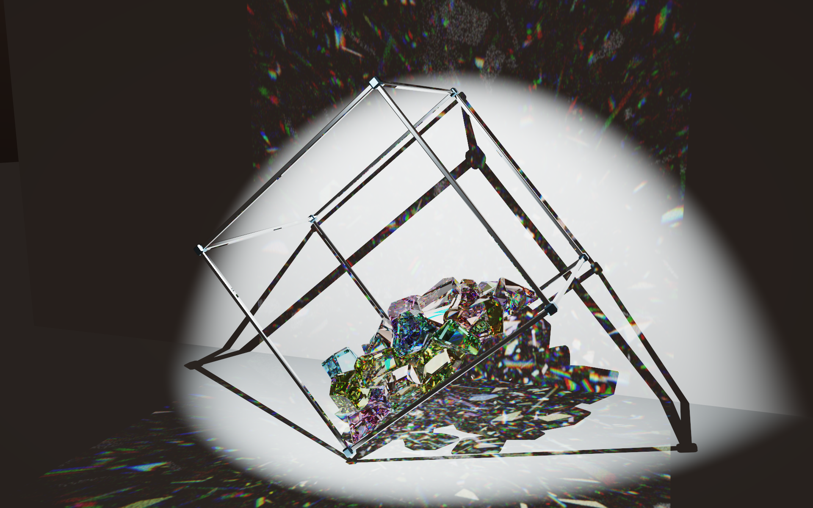
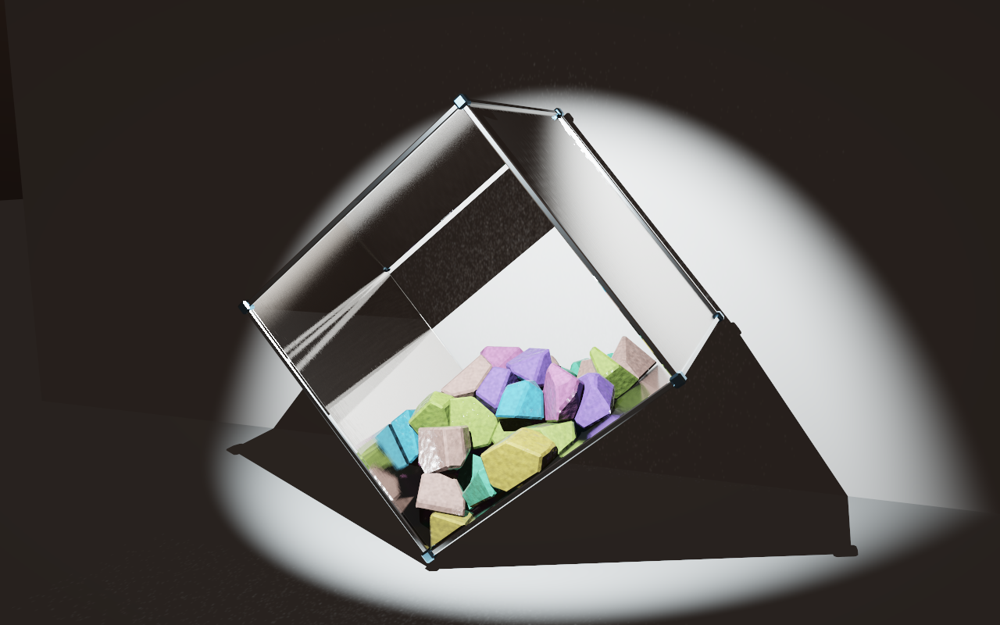

# Crystals

A native Windows crystal tumbler built with C++20, DirectX 12 hardware ray tracing, Bullet physics, and procedural glass audio.



## Features

- 1–96 true 3D Voronoi crystals cut from a box, faceted ellipsoid, cylinder, or octahedron with adjustable width, height, and depth. Tinted absorption, configurable refraction, and bevels on every edge.
- Live material controls: interior transparency (0–1), shine, reflectance, and crystal, rubber, stone, or paper surface presets with adjustable texture strength.
- Seven color palettes, random solid colors per piece, and four continuous 3D gradient styles painted through the original object. Live intensity, scale, offset, direction, and shuffle controls.
- Configurable ambient illumination alongside the spotlight, including when floating against black.
- Hardware ray queries for reflection, refraction, internal reflection, and color dispersion; photon paths produce colored caustics on the wall and floor.
- A rotating metal cube with six collision walls. Its four side walls can independently be invisible, paper, stone, or metal. A checkbox renders invisible walls, including both end walls, as thin glass. Crystals fall, tumble, slide, and collide inside it.
- Stable crystal optics for motion, plus a stochastic path-tracing mode and progressive still-image refinement.
- Spatial antialiasing enabled by default, borderless fullscreen, and an optional black environment without the floor or backdrop.
- Six approximate resonant modes per crystal and per glass wall. Collisions drive short taps; sliding drives irregular micro-impacts.
- Material presets also adjust contact friction, restitution, and modal sound. All shapes remain rigid, including paper and rubber finishes.
- Stereo impacts and scraping follow the camera's left/right view, with equal-power panning and adjustable width. Live audio controls for volume, decay, impact/scrape/wall levels, pitch, scrape density, and onset spread. Preferences persist between launches.
- Native OpenXR PC VR for Quest 2 over wired Link: stereo DXR, six-degree head tracking, Touch pointing and haptics, a floating settings panel, head-relative stereo audio, and adaptive eye resolution.

## Requirements

- Windows 10/11, x64, with a DirectX 12 GPU and driver supporting **DXR 1.1**.
- Visual Studio 2022 with **Desktop development with C++**.
- A Windows SDK containing the DirectX Shader Compiler (`dxc.exe`). Tested with SDK **10.0.26100.0**.
- CMake **3.24 or newer**.

The current implementation has been tested on an NVIDIA RTX 5070 and AMD Ryzen 9 9950X3D. It requires hardware ray-query support; there is no software rendering fallback. The sound engine uses Windows XAudio2 at 48 kHz stereo.

## Build and run

```powershell
git clone https://github.com/lukacslacko/crystals.git
cd crystals
cmake -S . -B build -G "Visual Studio 17 2022" -A x64
cmake --build build --config Release --parallel
.\build\app\CrystalSlab.exe
```

CMake finds DXC in the selected Windows SDK or on `PATH`. If your SDK is installed elsewhere, pass `-DDXC="C:/path/to/dxc.exe"` when configuring. To choose another output folder, pass `-DDELIVERY="C:/path/to/app"`.

Keep all ten `.cso` shader files beside `CrystalSlab.exe`. The build copies the license, dependency notices, and guides there too. Bullet 3.25, Dear ImGui 1.90.9 and Khronos OpenXR SDK 1.1.54 are vendored; no dependency download is needed during the build. The OpenXR loader is linked statically; a separate loader DLL is unnecessary.

## Quest 2 over wired Link

Enter the PC Link environment in the headset, launch the app, and press **F10** or use **Quest / VR… → Enter VR**. `CrystalSlab.exe --vr` starts directly in VR. The app prefers the installed Meta Quest / Horizon Link runtime for its own process without modifying the system OpenXR setting. The VR panel also offers the registered system runtime, such as SteamVR.

The cube starts 1.04 m across and 1.8 m in front of your initial head position. Lean and turn naturally. **Trigger** removes a crystal; **A** pauses, **X** rebuilds, **Y** recenters, and **B** shows a floating controls panel. Point and pull the trigger to use the panel; the right thumbstick scrolls it. All existing settings remain available there.

VR has separate quality settings, adaptive resolution, optional spectral dispersion and a live whole-stereo GPU timer. Meta's headset audio endpoint is selected when available. See [VR.txt](VR.txt) for setup, performance controls, runtime selection and diagnostics. Wired Link itself is configured using [Meta's setup guide](https://www.meta.com/help/quest/509273027107091/).

## Controls

| Control | Action |
| --- | --- |
| Right drag / mouse wheel | Orbit / zoom |
| Middle drag | Pan in the world XY plane, perpendicular to the cube's rotation axis |
| **Home** | Center the camera on the cube, preserving orbit and zoom |
| Left click a crystal | Remove it |
| **R** / Reset object | Reassemble the object resting on the cube's bottom wall and reset cube rotation |
| **Space** | Pause/resume physics and cube rotation |
| **M** | Mute/unmute |
| **Tab** | Show/hide controls |
| **F11** / Fullscreen | Toggle borderless fullscreen on the current monitor; **Esc** returns to the previous window |
| **F9** | Save a clean PNG beside the executable |
| **F10** / Quest / VR… | Enter or leave PC VR |

The panel controls cell count (1–96), index of refraction, bevel width, cube rotation, optics, and GPU rendering budget. **Audio settings** opens the sound panel. The default decay is approximately 20 ms, and impacts are independently staggered within an 8 ms window to avoid synchronized starts. Audio preferences are stored in `AudioSettings.ini` beside the executable.

**Stereo width** ranges from 0% (mono) through 100% (full spread across the cube, the default) to 200% (wider). Impacts, scraping, and wall sounds are positioned relative to the camera; orbiting and panning change their left/right placement. Short taps start at their contact position and keep that position through their decay. Panning preserves total signal power, and the limiter links both channels to preserve the stereo image.

**Materials…** opens the material panel. Choose a surface preset, then independently edit transparency, shine, reflectance, and structure. Transparency 0 gives an opaque tinted solid; 1 gives clear tinted transmission. Lower shine broadens highlights and roughens transmission. Reflectance sets the normal-incidence reflection strength independently of the refraction index. The structure slider controls procedural bump and pigment variation attached to each moving piece.

Set all four side walls together or expand **Set walls individually**. The names refer to their positions before rotation. Material preferences persist in `MaterialSettings.ini`. Changes preserve the current arrangement. Paper and stone panels receive crystal caustics; metal panels reflect the light paths.

Enable **Thin glass on invisible walls** to show the invisible sides and both end walls as clear, 0.035-unit glass panes. They reflect and refract light at IOR 1.5. The checkbox preserves paper/stone/metal finishes, collision boundaries, and sounds; crystals remain clickable through the glass. It is off by default and saved with the material settings.

**Original object…** selects a box, faceted ellipsoid (equal dimensions give a sphere), cylinder with its axis along Y, or octahedron. Width, height, and depth apply on slider release and rebuild the pieces. The assembled object starts at rest on the cube's bottom wall: the box and cylinder stand on their base, the octahedron is rotated onto a triangular face, and the ellipsoid rests at its lowest point. Placement uses the beveled collision hulls; pieces receive no initial kick. Gravity and frame rotation then drive the motion. Oversized dimensions scale together to fit inside a 5.05-unit radius, leaving room for even a single piece to tumble. **Restore original slab** returns to the 8 × 5 × 2.8 box. Object controls, like cell count, are session settings.

**Colors & lighting…** offers Pastel glass, Jewel tones, Ocean, Aurora, Ember, Earth, and Spectrum palettes. Use random solid colors per piece, or choose a directional gradient, radial gradient, three-axis color blend, or flowing bands. Gradients color the original solid throughout its volume, including cut faces and internal absorption; each fragment carries its own part as it moves. Adjust color intensity, gradient scale and offset, and the directional gradient's azimuth/elevation. **Shuffle piece colors** changes random assignments without restarting physics.

The same panel includes an **Ambient light** checkbox and **Ambient brightness** from 0 to 8×. The default 1× retains the original studio fill. Ambient light contributes to diffuse shading and reflections independently of the spotlight. Color and lighting preferences apply live and persist in `MaterialSettings.ini`.

**Float in blackness** removes the studio floor and backdrop, and makes the directly viewed background black. Ambient illumination remains available; disable it separately for spotlight-only lighting. This choice is saved with material preferences. **Antialiasing** is on by default: a spatial edge filter smooths the resolved image before the UI is drawn, without motion history or random jitter. Progressive ray sampling still refines paused views.

Glass panes sit 0.015 units outside the collision boundaries, avoiding coincident crystal and glass surfaces while preserving the pane thickness.



## Validation

```powershell
ctest --test-dir build -C Release --output-on-failure
```

The tests check Voronoi geometry, rotating-container physics, containment, modal decay, onset spreading, scrape behavior, audio controls, saved settings, peak limiting, material ranges, independently visible walls, and texture coordinates during rotation. Geometry tests cover all four source shapes at 1, 2, 8, and 96 cells, including oversized objects, slender shapes, the smallest dimensions, wide bevels, and removal of the last cell. Material tests check glass clearance, studio geometry, palettes and shuffling, color/lighting persistence, continuous source coordinates across moving fragments, and camera pan direction/plane invariants. They do not need a GPU or an audio output device. The audio test writes a procedural recording to `build/GlassAmbient.wav`.

Placement checks verify bottom-wall contact, horizontal support faces, intact initial assembly, zero initial velocity, and stable single-piece support before rotation begins.

Wall-motion tests verify contact velocities at slow and fast rotation speeds, during reversal and stopping, and across angle wrapping. A 96-piece, 0.5-unit object runs through both rotation directions to check that pieces stay near the supporting edge below the friction angle and slide to the next edge once the slope is steep enough.

To check the actual audio output device as well:

```powershell
.\build\Release\AudioValidation.exe .\build\GlassAmbient.wav --device-test
```

For a rendered still or a live GPU/physics test:

```powershell
.\build\app\CrystalSlab.exe --capture "$PWD/still.png" --settle 10 --samples 1536 --width 1920 --height 1200
.\build\app\CrystalSlab.exe --capture "$PWD/moving.png" --dynamic-test
.\build\app\CrystalSlab.exe --capture "$PWD/stone.png" --material stone --walls metal
.\build\app\CrystalSlab.exe --capture "$PWD/gradient.png" --material stone --color-mode 3d --palette aurora --ambient 3 --black-background
```

Capture overrides also accept `--transparency`, `--shine`, and `--reflectance` (0–1), `--mixed-walls`, and `--glass-walls`. Put the preset before its overrides. Also supported: --cells 1–96, --shape box|ellipsoid|cylinder|octahedron, --size WIDTH HEIGHT DEPTH, --black-background, and --no-aa. Captures start from default material settings, independent of saved UI preferences.

Color overrides: `--color-mode random|linear|radial|3d|flow`, `--palette pastel|jewel|ocean|aurora|ember|earth|spectrum`, `--color-intensity 0..2`, `--color-seed 0..1000000`, `--gradient-scale 0.25..4`, `--gradient-offset 0..1`, `--gradient-yaw -180..180`, and `--gradient-tilt -90..90`. Use `--ambient 0..8` or `--no-ambient` for lighting, and `--pan DX DY` to pan by a pixel offset at the capture resolution.

See [the detailed guide](README.txt) for rendering modes, command-line options, implementation notes, and recorded development measurements. The fast optics mode uses bounded ray branching, a fixed three-direction approximation for early rough reflection/refraction lobes, and approximate diffuse indirect light. The stochastic mode samples rough scattering progressively. Gradient absorption uses two deterministic quadrature samples per interior ray segment, avoiding stochastic volume noise. The audio uses a lightweight modal approximation rather than finite-element acoustics.

## License

The application is released under the [MIT license](LICENSE).

Bundled dependencies retain their own licenses: **Bullet 3.25** uses the zlib license and **Dear ImGui 1.90.9** uses the MIT license. Their original notices are retained in `vendor/` and [THIRD-PARTY.txt](THIRD-PARTY.txt).
